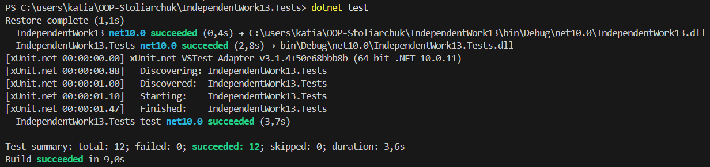

## Самостійна робота №13 
# Тема: Узагальнений кеш Cache<TKey, TValue> із тестами. 
# Мета: Розробити узагальнений клас кешу, який зберігає дані за ключем та має політику видалення найстаріших елементів (FIFO - First In, First Out), а також написати юніт-тести для перевірки його функціональності. Додатково можна реалізувати LRU як розширення базового рішення. 
# Висновок
У цій роботі я реалізувала узагальнений кеш з обмеженою ємністю та політикою FIFO. Навчилася поєднувати словник і чергу для зберігання даних та видалення найстарішого елемента. Також написала юніт-тести для перевірки основних операцій кешу.
# Відповіді на питання
1. Які переваги надає Cache<TKey, TValue> порівняно з окремими неузагальненими реалізаціями кешу?
Він працює з різними типами ключів і значень, забезпечує перевірку типів під час компіляції та усуває дублювання коду.
2. Чому для реалізації FIFO зручно поєднувати Dictionary<TKey, TValue> з Queue<TKey> або LinkedList<TKey>?
Dictionary забезпечує швидкий пошук значень, а Queue або LinkedList зберігає порядок додавання ключів, щоб можна було видалити найстаріший елемент.
3. Коли Get повинен викидати KeyNotFoundException, а коли доцільніше використовувати TryGetValue?
Get викидає виняток, якщо ключ відсутній. TryGetValue доцільний, коли відсутність ключа очікувана: він повертає false без винятку.
4. Які тести критично важливі для перевірки витіснення елементів із кешу?
Потрібно перевірити видалення найстарішого елемента, збереження решти значень і дотримання ємності. Також важливо перевірити повторне переповнення та незмінність порядку FIFO після читання.
