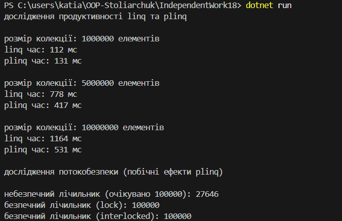

# Cамостійна робота No18
## Тема: PLINQ: дослідження продуктивності та безпеки.
## Мета: Дослідити переваги та недоліки PLINQ (Parallel LINQ) у порівнянні зі звичайним LINQ, виміряти його продуктивність на різних обсягах даних та проаналізувати потенційні проблеми безпеки при паралельній обробці.

## Аналіз та висновок
Продуктивність: На колекції 1 млн елементів звичайний LINQ спрацював швидше (112 мс проти 131 мс), оскільки накладні витрати PLINQ на створення потоків перевищили виграш від паралельності. На обсягах 5 млн та 10 млн PLINQ виявився швидшим майже вдвічі (417 мс та 531 мс), бо велике навантаження ефективно розподілилося між ядрами процесора. Побічні ефекти: Небезпечний лічильник видав 27646 замість 100000 через гонку даних — кілька потоків одночасно читали і перезаписували спільну змінну, втрачаючи інкременти. Використання lock (блокування доступу для інших потоків) та Interlocked (атомарні операції) повністю усунуло проблему, видавши точний результат 100000.
PLINQ доцільно застосовувати виключно для великих масивів даних і складних обчислень, обов'язково забезпечуючи потокобезпечність при роботі зі спільними ресурсами.
## Відповіді на питання 
1. За яких умов PLINQ зазвичай дає виграш у продуктивності порівняно зі звичайним LINQ?
PLINQ дає виграш на великих обсягах даних та складних обчисленнях, де час виконання завдання значно перевищує час, витрачений системою на створення та керування потоками.
2. Чому побічні ефекти всередині PLINQ-запитів можуть призводити до некоректних
результатів?
Паралельні потоки одночасно звертаються до спільної пам'яті без синхронізації, що призводить до втрати або перезапису даних (гонка даних).
3. Для чого в експериментах важливо порівнювати кілька розмірів колекції, а не один випадок?
Різні розміри колекції дозволяють знайти точку беззбитковості — межу, після якої витрати на розпаралелювання стають меншими за отриманий виграш у швидкості.
4. Які висновки слід зробити, якщо PLINQ виявився повільнішим за LINQ у частині тестів?
Якщо PLINQ повільніший, це означає, що колекція занадто мала, операція занадто проста, або є вузькі місця у вигляді постійних блокувань спільного ресурсу.
