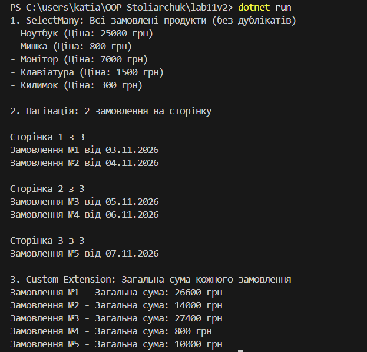

## Лабораторна робота №11 
# Тема: LINQ: SelectMany, пагінація й custom extensions.
# Мета: Навчитися використовувати оператор SelectMany для роботи з вкладеними колекціями, реалізовувати пагінацію даних за допомогою LINQ, а також створювати власні методи розширення для IEnumerable<T> або ключових доменних сутностей.
# Висновок
У цій лабораторній роботі було закріплено навички роботи з LINQ для маніпуляції вкладеними колекціями. За допомогою SelectMany вдалося ефективно "розгорнути" ієрархію Order -> OrderDetail для отримання єдиного плоского списку всіх продуктів. Також було успішно реалізовано механізм посторінкового виведення (пагінації) за допомогою комбінації методів Skip() та Take(), і створено власний метод розширення TotalOrderAmount(), який інкапсулює бізнес-логіку підрахунку загальної вартості деталей замовлення.
# Відповіді на питання
1. Для чого використовується оператор SelectMany? Наведіть приклад, що демонструє його відмінність від Select. 
 SelectMany використовується для "розгортання" вкладених колекцій у єдину плоску послідовність, тоді як звичайний Select повернув би колекцію колекцій.
2. Як реалізувати пагінацію даних за допомогою LINQ? Які методи для цього використовуються?
Пагінація реалізується комбінацією методів Skip(), що пропускає потрібну кількість елементів, та Take(), що бере наступні, за формулою Skip((сторінка - 1) * розмір).Take(розмір).
3. Поясніть концепцію методів розширення. Як вони інтегруються з LINQ?
Методи розширення дозволяють додавати новий функціонал до існуючих типів без зміни їхнього коду; вони реалізуються як статичні методи і безшовно інтегруються з LINQ.
4. Наведіть приклад власного методу розширення для IEnumerable<T> та поясніть його призначення.
Власний метод розширення TotalOrderAmount(this IEnumerable details) інкапсулює логіку підрахунку загальної суми деталей замовлення, що приховує складний запит із Sum та робить код чистішим для повторного використання.
